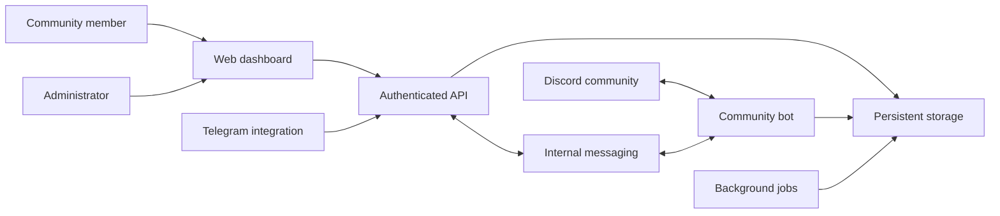

# Architecture overview

[← Allora Dashboard](README.md)

| Layer | Responsibility |
|---|---|
| Web dashboard | Present community tools and member/admin workflows. |
| API | Authenticate requests, validate input and enforce access boundaries. |
| Bot | Handle Discord events, commands and community interactions. |
| Messaging | Coordinate requests between the web service and bot. |
| Persistent storage | Store community configuration and application records. |
| Background jobs | Process scheduled and recurring work. |
| External integrations | Connect supported music, AI and Telegram services. |

The implementation uses TypeScript, React, Fastify, Discord.js, PostgreSQL and Redis, with Docker for service packaging. This diagram is intentionally conceptual: it does not expose hostnames, ports, credentials, schema details or operational endpoints.

Permissions must be enforced by the backend; hiding an interface control is not an authorization boundary. External services have independent availability and access requirements.
