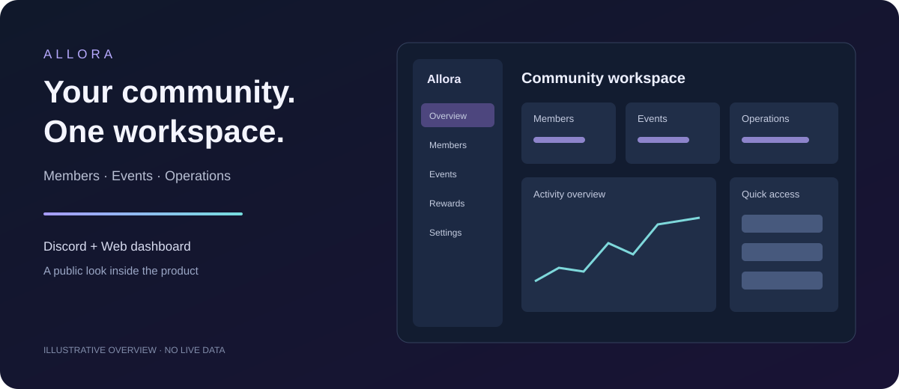

<h1 align="center">Allora Dashboard</h1>

A connected workspace for Discord community operations.

<strong>English</strong> · <a href="README.ru.md">Русский</a> · <a href="README.uk.md">Українська</a>

<a href="#what-allora-brings-together">Capabilities</a> · <a href="ARCHITECTURE.md">Architecture</a> · <a href="UPDATES.md">Updates</a> · <a href="FAQ.md">FAQ</a>

## About the project

Allora connects a Discord bot, a web dashboard and supporting services to help communities manage everyday activity. Members and administrators see different tools according to their roles and permissions.

This repository is a public product overview. The application source and operational configuration are maintained privately. There is no downloadable bot, self-hosting package or executable dashboard here.

## What Allora brings together

| Area | Purpose |
|---|---|
| Community overview | Bring relevant activity and community tools into one dashboard. |
| Members | Browse member information, profiles and activity records. |
| Moderation | Manage warnings, review workoffs and follow moderation workflows. |
| Applications and contracts | Configure submission forms and review processes. |
| Activity and rewards | Track activity, points, milestones, quests and referrals. |
| Community economy | Manage shop items, purchases, cases and inventory. |
| Events | Organize event reports, participation and reward workflows. |
| Scheduling | Configure timers, reminders and scheduled publications. |
| Music | Search for music and control voice-channel playback through supported integrations. |
| AI assistant | Help members find information and assist authorized operators with supported tools. |
| Telegram integration | Connect supported Telegram updates to community workflows. |
| Administration | Configure features, roles and integration settings. |

Availability depends on community configuration, permissions and external services. This overview describes the project scope, not a promise that every feature is enabled for every community.

## Dashboard experience

- Member and administrator views with access-aware navigation.
- Light and dark themes, with layouts for desktop and mobile screens.
- Forms, lists and status messages designed around common community tasks.
- Ongoing work on accessibility, responsive layouts and reliable interactions.

The banner is a schematic illustration, not a screenshot of a live community. It contains no real member data.

## Technology and architecture

The private implementation uses TypeScript, React, Fastify, Discord.js, PostgreSQL, Redis and Docker. The web interface, API, bot and background processing have separate responsibilities. Read the [architecture overview](ARCHITECTURE.md) for a high-level explanation.

## Project updates

This showcase receives only curated public documents and a deployment update marker. It does not mirror private commits, source files, internal plans, logs or credentials. See [updates](UPDATES.md).

Development priorities include clearer dashboard navigation, improved mobile layouts, accessibility and dependable operations. An update marker is not a guarantee of uptime or successful connectivity to every external service.

## Questions and access

For public questions, contact [the project owner](https://github.com/alexkuz2014). Do not submit tokens, personal records or private community data in public discussions. See the [FAQ](FAQ.md) for access and source-code questions.
